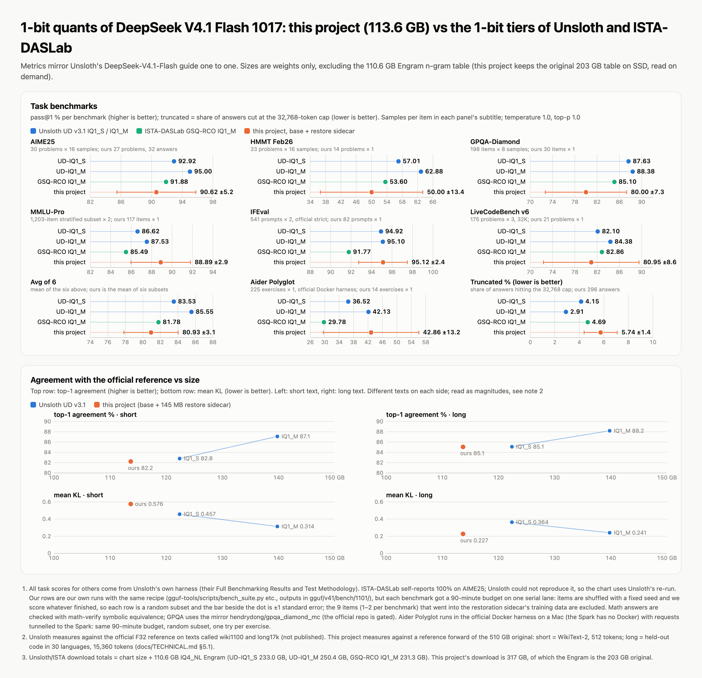

> **Why it is built this way**
>
> There is no free lunch. Whatever size quantization saves is paid for somewhere else.
>
> I quantize every domain with equal weight so that every person, every industry and every country starts from the same,
> consistent base; specialised abilities are added as plug-ins (sidecars, post-training files), by whoever needs them.
> Making the numbers look good at the cost of the model's marginal abilities is not what I want.
>
> Next goal: self-evolving restoration.

<p align="center">
  
</p>

<h1 align="center">YoungAi</h1>

<p align="center">
  <b>A personal AI assistant that lives on your own machine.</b><br>
  Hold to talk. It remembers what you tell it, browses the web, writes Word/PDF/PowerPoint/Excel files, makes videos, keeps
  following up on a job, and hands the result to the next app on your phone. Model, memory and files all stay on the box.
</p>

<p align="center">
  <a href="https://github.com/fodelf/YoungAi"><b>GitHub repository · fodelf/YoungAi</b></a> ·
  <a href="https://fodelf.github.io/YoungAi/"><b>Website · user guide</b></a> ·
  <b>English</b> · <a href="https://github.com/fodelf/YoungAi/blob/restructure/README.zh-CN.md">中文</a> ·
  <a href="https://huggingface.co/wenzhouwu/YoungAi-DeepSeek-V4.1-Flash-1017">Hugging Face</a> ·
  <a href="https://github.com/fodelf/YoungAi/blob/restructure/docs/TECHNICAL.md">Technical notes</a>
</p>



**Read the magnitudes, not a ranking.** Our rows are small random subsets (296 answers plus 14 Aider exercises, 90 minutes
per benchmark, error bars ±2.4 to ±13.4 points); the 9 items that went into the sidecar's training data are excluded.
Sample sizes and what the low GPQA / HMMT rows are: [technical notes §5.1](docs/TECHNICAL.md#51-quality).

**These scores do not stand for what the model can actually do.** The pelican test below shows it: same model, same task,
benchmark scores barely move, and the drawings are a step apart.

Same prompt ("create an HTML page with a 2D SVG animation of a pelican riding a bicycle"), same agent flow (dsh):

| Official DeepSeek V4.1 Flash (510 GB original, official API) | This project, Oct 27: restore sidecar before self-learning | This project, Oct 30: after 8 kept rounds of self-learning |
|:---:|:---:|:---:|
|  |  |  |

Both local runs use the same 113.6 GB base plus the restore sidecar on one machine; only the sidecar's correction changed
in between. One run each, not hand-picked. What changed between the two drawings, and the rulers that barely moved:
[technical notes §5.1](docs/TECHNICAL.md#51-quality).


The model behind it is DeepSeek V4.1 Flash, the 1017 release (510 GB as published), shrunk to 113.6 GB and running on one
128 GB machine, a DGX Spark or an Apple Silicon Mac, with a 1M-token context. Open source, MIT. Plain C99 + CUDA on the
Spark, Metal on the Mac, one Makefile, no third-party libraries linked.

## The model

A 113.6 GB base plus a 145 MB restore sidecar and a 13 MB index patch picks the same next token as the 510 GB original
weights (Same top) **85.2%** of the time on code:

| | Size | Code | General English |
|---|---:|---:|---:|
| ① base | 113.6 GB | 78.4% | 76.8% |
| ① + ② code sidecar | + 41 MB | 82.0% | 79.7% |
| ① + ② + ③ post-training | + 101 MB | 84.8% | 82.4% |
| ① + restore sidecar | + 145 MB | 85.1% | **82.2%** |
| **① + restore sidecar + index patch (default on the Spark)** | **+ 13 MB** | **85.2%** | 81.6% |

"Same" means that on the same text, our model and the original rank the same token first; code is 15,360 held-out
tokens across 30 languages, general English is WikiText-2. Mean KL per row, what the index patch is, and the full tables:
[technical notes §5.1](docs/TECHNICAL.md#51-quality).

**Three things get 113.6 GB this far:**

1. **Multimodal loads on demand and unloads after use.** The vision tower (0.97 GB, original BF16) is a separate file; at
   start-up the engine only records where it sits on disk. It is read into GPU memory when an image arrives and released
   when that image is done; a text request never touches a byte of it. So almost all of the 128 GB goes to the text
   backbone: a 113.6 GB base with 8 weights vector-quantized together, ~1.6 bit/weight, no training data used.
2. **A 41 MB sidecar.** A gain on every row of every routed expert plus a small bias on each router, solved against the
   original weights. One per domain (finance / code / law / medicine / science), switched from the chat box in under a
   second.
3. **A 101 MB post-training file.** A rank-64 correction on the output of every MoE layer, taught by the 510 GB original
   itself: it learns the original's next-token distribution at every position. The code used for scoring shares not a
   single 24-token stretch with the training data, and general English rises 2.7 points as well: it fixes the quantization
   error itself rather than memorizing.

**The restore sidecar** puts both pieces in one directory: gains and router biases like ② (40 MB), a rank-64 correction
like ③ (105 MB). Its correction keeps learning from source files the official API writes fresh. No training text shares a
16-token stretch with either ruler, apart from two lines of Dockerfile boilerplate. Pass the directory to
`ds4-server --zchain`; the index patch (`posttrain-restore-20261103`) goes on top with `--posttrain`.

Context is 1M tokens; the full KV cache is 0.89 GB. Method and full tables: [technical notes §5](docs/TECHNICAL.md#5-results);
how the post-training file is made: [§4.3](docs/TECHNICAL.md#43-the-post-training-file).

### Speed

| | DGX Spark (GB10, 128 GB) | Mac Studio M5 Max (128 GB) |
|---|---:|---:|
| Reading the prompt | 1,040–1,070 tokens/s (9.2k-token prompt) | 627 tokens/s (25.5k-token prompt) |
| Writing, speculative decoding (default) | 48.2 tokens/s | 35–36 tokens/s prose, 41–42 code |
| Writing, plain decoding | 29.9 tokens/s | not measured |
| Measured by | us | a contributor ([#3](https://github.com/fodelf/YoungAi/pull/3)) |

Both columns use the same 113.6 GB base, temperature 0 and 512 written tokens. The Spark numbers come from a real
request that was never used for tuning, with the coding sidecar on. The Mac numbers come through `ds4-server`, best of two
runs. The prompts differ, so compare the columns roughly rather than digit by digit. More workloads and context lengths:
[technical notes §5.2](docs/TECHNICAL.md#52-speed).

**On a Mac**, `make` builds the Metal version and 133 GPU kernel tests pass on a real Apple GPU. Our own Mac has 16 GB, so
the full-model numbers above are the contributor's.

## What it does

**A request comes in, the assistant does the work in a sandbox, then hands the result on.** The screenshot above is a
real run: "find me the cheapest DGX Spark on the web" took 16 minutes, 12 rounds and 43 tool calls, all on the machine itself.

| You say | It does | You get |
|---|---|---|
| "Anything good to eat nearby?" (on a phone) | locate → nearby places → picks 3 with reasons | a *Navigate* button and an *Open in Meituan / Ele.me* button for each |
| "Turn this Word file into a PDF" (attachment) | converts it inside the sandbox | a file card: download, or share to WeChat / DingTalk |
| "Look into X and write it up for my colleague" | searches, reads the sources, writes a docx | the report plus the system share sheet |
| "Sum this table by month" | reads the csv, writes an xlsx with formulas | an Excel file whose numbers show on a phone |
| "Make a 30-second product video with narration" | writes an HTML animation, renders and encodes it frame by frame | a narrated mp4 any phone player can play |
| "Watch this price and tell me when it drops below X" | creates a task and decides itself when to look again | a push notification on your phone |
| "Remember I mostly live in Nanjing" | writes it to memory | trip plans start from Nanjing from then on |

The assistant's tools (this table is what the model sees; there is no scenario-specific prompt):

| Group | Tools | Notes |
|---|---|---|
| Memory | `remember` `forget` | only what you said yourself; plain text under `~/.ds4/assistant/memory/` you can edit |
| Files | `read_file` `list_dir` `search_files` `write_file` `edit_file` | the workspace by default; a path outside it shows a card asking you first |
| Programs | `run` | runs a command in the kernel sandbox: no network, writes only to the workspace; uses soffice / pandoc / python3 etc. if installed |
| Web | `web_search` `visit_page` | headless Firefox: search and page text |
| Office files | `write_document` `write_xlsx` | Markdown → docx / pdf / pptx; JSON → xlsx with formulas computed. All written in-house, no Office needed |
| Video | `make_video` | the model writes an HTML animation; our own H.264/AAC encoder turns it into an mp4, optionally narrated |
| Places | `locate` `nearby` | phone location + AMap nearby search (real places with an AMap key; a street-scoped web search without one) |
| To your phone | `share` `copy_text` `navigate` `call` `open_url` `open_app` `read_clipboard` `pick_file` | run on the device you are using; opens Douyin / WeChat / DingTalk / Alipay / Meituan / Ele.me |
| Follow-up | `task_check_in` `task_done` `notify` | a task picks its own next check; reminders and "done" notices go to your phone (Web Push) |
| Skills | `use_skill` | a folder with a `SKILL.md` teaches it how to do a kind of job (Agent Skills format, no scripts allowed) |
| Cloud phone | six `phone_*` tools | only in danger mode; see the disclaimer at the end |

### Voice input: hold to talk

Like WeChat: with the input box empty, the rightmost button is a microphone; tap it to get a "Hold to talk" bar, hold
and speak, and let go to **send right away**. Slide up before letting go to cancel. The limit is 30 seconds. Speech
recognition also runs on the machine's GPU, so the audio never leaves it.

- The recognizer is [moonshine-tiny-zh](https://huggingface.co/moonshine-ai/moonshine-tiny-zh) (27M parameters, 108 MB),
  run by this project's own C + GPU kernels (CUDA / Metal), with no Python or ONNX. On the Spark a 3.4-second utterance
  takes 51 ms to transcribe.
- **Chinese only.** It is the smallest tier: the paper reports a 29–36% character error rate on hard test sets
  (crowd-sourced recordings, many accents). Speaking clearly into a phone does much better, but it is a notch below large models.
- **To turn it on**, put the model's files in `gguf/asr/moonshine-tiny-zh/` and load the model again on *Models*; a
  microphone appears next to the input box. Without that folder the feature simply does not exist: no microphone, no error.

  ```sh
  mkdir -p gguf/asr/moonshine-tiny-zh && cd gguf/asr/moonshine-tiny-zh
  for f in config.json tokenizer.json model.safetensors LICENSE.txt; do
    curl -fLO https://huggingface.co/moonshine-ai/moonshine-tiny-zh/resolve/main/$f
  done
  ```

- Browsers only grant the microphone over https or localhost; over `http://<LAN-IP>` there is no microphone, and the
  rightmost button is just Send.
- Status: transcripts on the Mac (Metal) and the Spark (CUDA) match the official reference implementation character for
  character, and the production server on the Spark passed a smoke test. A real phone has been tried on a few sentences (two
  wrong characters in three); the formal acceptance run (10 sentences on each of three phones) has not been done yet.

## Safety: the sandbox, not trust in the model

- **Every tool call runs in a fresh child process that locks itself into a kernel sandbox first**: Landlock + seccomp on
  Linux, Seatbelt on macOS. If the sandbox cannot be applied, the call is refused. Thirty-odd escape tests pass on both the
  Mac and the Spark.
- **The gatekeeper is one deterministic C function**, not a second model acting as judge. Writes and deletes outside the
  workspace need your OK (this once / this session / always); arguments that look like passwords, card numbers or one-time
  codes are refused outright; the assistant cannot touch its own config directory, so it cannot grant itself permissions.
- **Web content is untrusted input**: after reading a page, standing approvals for outbound actions stop applying.
- **Every action is one line in an audit log** (`audit.jsonl`), browsable on the *Activity* tab, where approvals can be revoked.
- The honest limit: there is no VM. The assistant runs as your user; if the machine is compromised, so is the assistant.

## Get started

**On a DGX Spark** (Linux aarch64 with the CUDA 13 runtime, ~320 GB free SSD). The web tools need Firefox, which
Ubuntu on the Spark ships.

```sh
# YoungAi — GitHub repository fodelf/YoungAi
git clone https://github.com/fodelf/YoungAi.git ~/ds4-main && cd ~/ds4-main
make cuda-spark
./ds4-train --host 0.0.0.0 --port 8000      # open http://<host>:8000/
```

1. **Models**: press *Download* (~317 GB, resumable), then *Load* (~2 minutes).
2. **Assistant**: just talk. Conversations, memory and the workspace live in `~/.ds4/assistant/`.
3. **Phone**: open the page and *Add to Home Screen* to get an app. Location, clipboard, sharing and push need https:
   enter a cloud server in *Settings* and turn on the tunnel, or use Tailscale. Steps and troubleshooting:
   [docs/pwa.md](docs/pwa.md) (Chinese).
4. **Tasks**: type one sentence to hand a job over.
5. **Skills**: create one, or import a folder with a `SKILL.md` (the repo ships one for slide decks: [`skills/pptx/`](https://github.com/fodelf/YoungAi/tree/restructure/skills/pptx)).

How every tab and every tool works, and what happens when something goes wrong: the
**[user guide](https://fodelf.github.io/YoungAi/guide.html)**.

**On a Mac** (Apple Silicon with 128 GB, ~325 GB free SSD), run the model server directly. The Studio's *Download* and
*Load* buttons have only been run on the Spark.

```sh
# YoungAi — GitHub repository fodelf/YoungAi
git clone https://github.com/fodelf/YoungAi.git ~/ds4-main && cd ~/ds4-main
make                                                            # Metal build
bash gguf-tools/scripts/hf_install.sh download --dir ~/youngai   # ~317 GB, resumable
M=~/youngai/model/DeepSeek-V4.1-Flash-1017-vq8sh14-q4k-mtpnative
./ds4-server --metal -m $M.gguf --zchain $M-grrb-code_fit_n15360-engine \
    --posttrain ~/youngai/model/posttrain-code-20261022 \
    --engram-dir ~/youngai/deepseek-engram --mem-budget-mb 110000 --port 8000   # OpenAI / Anthropic API on :8000
```

The `--posttrain` line adds the post-training file, which pairs with the code sidecar; drop it to run the sidecar alone.

If the server says a model range is *not covered by mapped model views*, the build predates Mac support: pull and run
`make` again.

## Two more things it does

**Train on your own data.** One JSON object per line, in either of Unsloth's two shapes; drop the file on *Data*, press
*Start* on *Train*. Nothing is mounted automatically: turn on the *Post-train* switch next to the chat box to use it.
Full walk-through: [technical notes §4.3](docs/TECHNICAL.md#43-the-post-training-file).

```json
{"messages":[{"role":"user","content":"What was the entry price?"},{"role":"assistant","content":"30.39"}],"context":"…the source document…"}
{"text":"Raw text, trained as-is (continued pretraining)."}
```

**Use it as an API.** `/v1/chat/completions`, `/v1/completions`, `/v1/responses`, `/v1/messages` (OpenAI / Anthropic
compatible). Create a key on the *API* tab and send `Authorization: Bearer <key>` (also from localhost; without it you get
401). `"temperature": 0` gives byte-identical output every run. With the speech model installed there is also
`/v1/audio/transcriptions`: the request body is a 16 kHz mono WAV as-is (not OpenAI's multipart form) and the reply is
`{"text":"…"}`; other sample rates or formats get a 400 saying what arrived. API only, no Studio, no build:

```sh
curl -fsSLO https://huggingface.co/wenzhouwu/YoungAi-DeepSeek-V4.1-Flash-1017/resolve/main/install.sh
bash install.sh                      # --domain law for another domain (default: code); --endpoint https://hf-mirror.com for a mirror
bash install.sh --posttrain          # also load the post-training file (pairs with the code sidecar)
```

## Limits

- We test end to end on the DGX Spark. The Mac's full-model numbers come from a contributor's M5 Max; our own Mac has
  16 GB, so on it we only run the GPU kernel tests.
- One machine, one model: background tasks and your chat take turns rather than running in parallel.
- Sites behind a login or a captcha stay closed to the assistant; it says what it could not open instead of guessing.
- The per-domain sidecars and the post-training file are scored on held-out text only. The restore sidecar has also run
  the task benchmarks at the top of this page, on small subsets.
- The post-training file makes long reasoning stop earlier than the original: on two real reasoning runs of 10–30k
  tokens, the chance of stopping is 1.6–2× the original's, so hard problems may get a few steps less thought. Leave it
  off if that matters (`install.sh` without `--posttrain`, or no `--posttrain` on `ds4-server`).
- The Studio's *Post-train* switch only lists files trained on this machine; the one from Hugging Face is loaded with
  `install.sh --posttrain` or `ds4-server --posttrain`.

## Danger mode (experimental) — disclaimer

Settings has a **Danger mode** switch, **off by default**. Turning it on starts a virtual Android 13 phone on the host
(Linux only: the kernel needs `binder`; macOS cannot run it) and gives the model six `phone_*` tools: look at the screen,
tap, swipe, press keys, type, open apps. The workbench gets a **Phone** tab with the live screen (H.264 stream decoded by
your browser), and `/api/phone/*` is a plain REST API that the page, the model and your own scripts all share
([`docs/assistant_phone.md`](https://github.com/fodelf/YoungAi/blob/restructure/docs/assistant_phone.md)). Read this before you flip the switch:

- **The model acts on its own.** With danger mode on, nobody confirms ordinary taps. The phone starts empty (no SIM, no accounts,
  no app store), but **any account you sign into and any APK you install there, the model can use** — it may send messages,
  place orders, pay, or delete things. Whoever turns the switch on bears the consequences.
- **The step that actually pays asks you first, every time.** Filling in an amount or tapping "Transfer" / "Buy now" goes
  through; before a tap, swipe or Enter on a window the app marks as secure (password, payment, login pages) or on a button
  reading Pay / Place order / 确认支付 …, a red card appears: a fresh screenshot with the spot it wants to tap and the amount on
  screen, or, for a secure window that cannot be captured, the last screen before it (who gets how much). It can only be allowed
  once and is never remembered; one approval on a secure window covers the rest of that window and ends when it closes.
  The model cannot type on secure windows: you type passwords yourself in the Phone tab. This catches the pages it can recognise:
  a final pay button with no UI text on a window not marked secure goes through unasked.
- **Screen content is untrusted input.** Text inside apps and web pages can try to instruct the model. The phone runs in its
  own namespaces with a hard memory cap and cannot reach your LAN or the host, but this is not a guarantee against every misuse.
- **It will not bypass anti-bot checks.** If an app shows a slide captcha or a risk-control screen, you do it yourself in the
  Phone tab; the model is not told to get around it. Do not use this to circumvent any app's terms of service or other
  people's rights.
- The phone system is a third-party image ([redroid](https://github.com/remote-android/redroid-doc), Apache-2.0) that this
  project's runtime (`ds4-phone`, ~600 lines of C, no Docker) boots directly; its one-time setup needs `sudo` once
  (`scripts/phone_prepare_linux.sh`).
- The live video needs a secure context (https, or the page opened as `localhost`); over plain `http://<LAN-IP>` browsers
  withhold WebCodecs and the tab falls back to one screenshot per second.

## Author · acknowledgements · license

Wenzhou Wu (吴文周) · 310066827@qq.com. Questions, reproduction reports and collaboration are welcome; bugs and pull
requests go to [GitHub repository · fodelf/YoungAi](https://github.com/fodelf/YoungAi).

YoungAi started as a fork of [antirez/ds4](https://github.com/antirez/ds4) (DwarfStar, Salvatore Sanfilippo's DeepSeek V4
engine). GGUF, layouts such as q4_K and much kernel know-how come from [llama.cpp and GGML](https://github.com/ggml-org/llama.cpp);
the GGML copyright notice stays in `LICENSE`. The model is DeepSeek's; thanks for releasing the weights and the reference code.

Engine: MIT ([`LICENSE`](LICENSE)). The quantized weights derive from DeepSeek V4.1 Flash (1017), also MIT
([`LICENSE-DeepSeek`](LICENSE-DeepSeek)).

Voice input is Powered by Moonshine AI. The moonshine-tiny-zh recognizer is **not MIT**; it is under the Moonshine AI
Community License: free for research and non-commercial use; commercial use requires registering at
moonshine.ai/community-license, the license ends automatically once you and your affiliates exceed US$1M in annual
revenue, and its outputs may not be used to train foundation models. This repository does not ship its weights; using it is your call.
